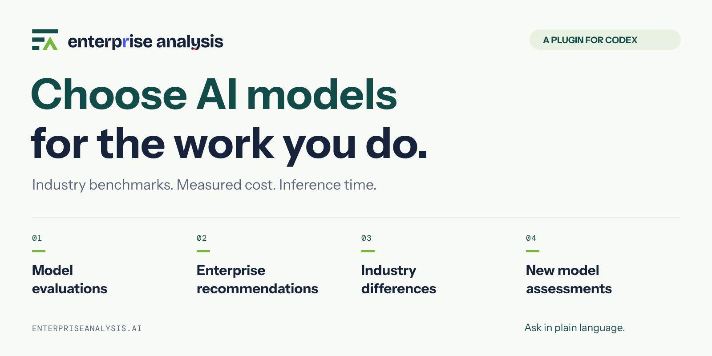
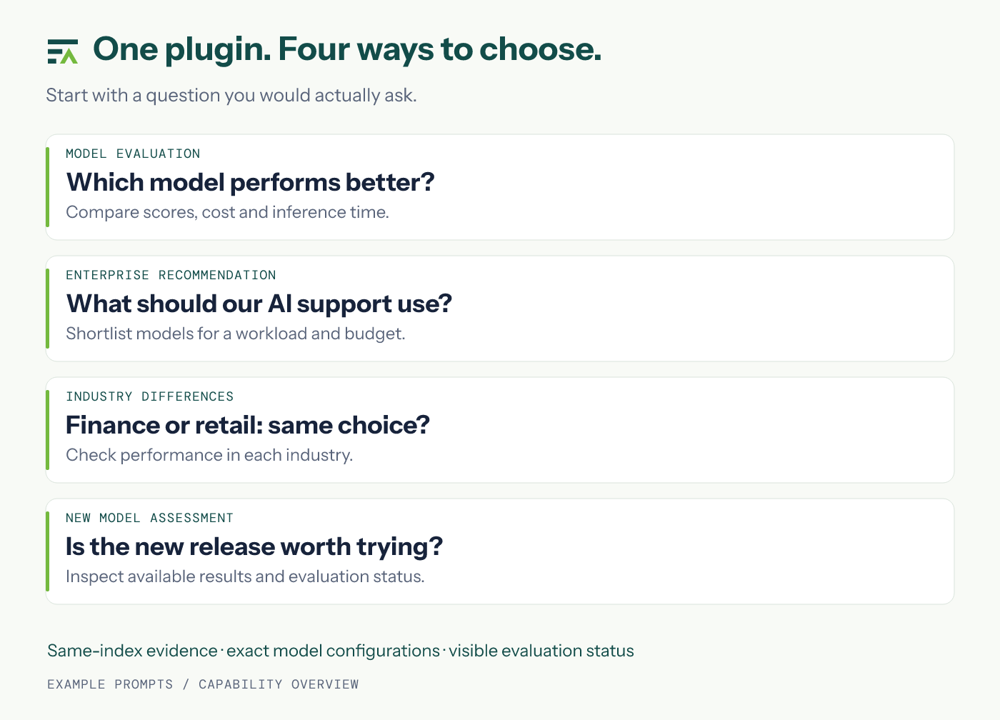

# Enterprise Analysis for Codex

**Choose models for your business with industry scores, measured benchmark costs and inference times, directly in Codex.**

[中文说明](README.zh-CN.md) · [Explore the benchmarks](https://enterpriseanalysis.ai/?lang=en) · [Install locally](#install-in-codex) · [Try a prompt](#try-it)

Ask which model fits your workload, how GPT and Claude compare in your industry, or whether a new release deserves a closer look. The plugin queries Enterprise Analysis and gives Codex the evidence to explain its recommendation.

## Four ways to use it

| You need to… | Ask Codex… | Get… |
| --- | --- | --- |
| Compare models | “How do GPT and Claude compare in finance?” | Results for specific models and reasoning settings in the same EA index. |
| Choose a model for work | “We need an AI support agent. What should we use? Keep costs down.” | A benchmark-based shortlist, with score, measured cost and time tradeoffs. |
| Understand industry differences | “Would you pick the same model for finance and retail?” | Industry-level scores and available industry-specific usage. |
| Assess a new release | “Has this new model been evaluated? Is it worth trying?” | Available EA results, release dates and evaluation status. |

## Install in Codex

This is a local development plugin. It is not published in the public directory. You need Node.js 20+ and a local copy of this repository. Run from the repository root:

```sh
git clone https://github.com/enterpriseanalysis/enterprise-analysis-plugin.git
cd enterprise-analysis-plugin
npm ci
codex plugin marketplace add .
codex plugin add enterprise-analysis@enterprise-analysis-dev
```

Open a new Codex chat. If the desktop app does not load the plugin, fully quit and reopen it. If your client copies the package without dependencies, run `npm ci` in the installed path reported by the install command. See [troubleshooting](docs/development.md#troubleshoot-startup).

Public EA data reads require no EA account or API key.

## Try it



Copy a prompt into a new chat:

```text
How do GPT and Claude compare in finance?
```

```text
We need an AI customer support agent. Which model should we use?
Keep it affordable and responsive.
```

```text
Would you choose different models for finance and retail?
```

```text
Has the new model been evaluated yet? How does it compare with the previous version?
```

Name the versions you care about, or let Codex ask you to narrow them down. For a first connection check, explicitly name the plugin:

```text
Use Enterprise Analysis to compare GPT and Claude on finance benchmarks.
```

**Check the activity trace:** loading the `Evaluate Models` skill supplies workflow guidance. Calls such as **Find EA models and industry dimensions** and **Compare AI model benchmark results** retrieve data through the plugin. A web search or a skill load alone does not confirm an EA data query.

## Evidence you can inspect

Comparisons preserve exact model versions, reasoning settings, source links, available coverage counts and evaluation status. Automated recommendations require explicit completed and undisputed status. Cost limits require full priced-case coverage; missing values remain unknown.

The tools use the same selected index for a comparison. Costs are measured USD per benchmark case, and times are benchmark inference times. They do not establish your production bill, time to first token or end-to-end support latency.

Recent-release queries cover models present in the selected EA index with day-precision release dates. The plugin reads existing evaluations; it does not launch new benchmark runs, train models or deploy an application.

## Included tools

| Tool | Purpose |
| --- | --- |
| `discover_evaluations` | Find model configuration keys, indexes and industry dimensions. |
| `compare_model_evaluations` | Compare named models on scores, measured case costs and inference times. |
| `recommend_enterprise_models` | Filter candidates by industry, minimum score, measured case cost and time limits, then rank by score. |
| `compare_industry_performance` | Inspect the same models across industry dimensions. |
| `get_new_model_evaluations` | Find EA-indexed releases within a date window, including evaluation status. |
| `get_evaluation_methodology` | Read index methodology and scoring details. |

The plugin packages one selection skill and a local read-only MCP server. Automatic selection depends on the host and the request; local installation does not provide recommendations to uninstalled users.

## Development and sources

- [Run, configure and troubleshoot the server](docs/development.md)
- [Backend field semantics](docs/backend-contract.md)
- [Validation records](docs/validation.md)
- [Prompt evaluation set](evals/prompts.json)
- [Brand assets and image sources](docs/brand-assets.md)

The adapter sends only an index key to the backend; model and industry filtering run locally. It sends no conversation history, user files or credentials and adds no request-body logging. EA’s upstream service may keep operational logs under its [privacy policy](https://enterpriseanalysis.ai/legal/privacy?lang=en).
