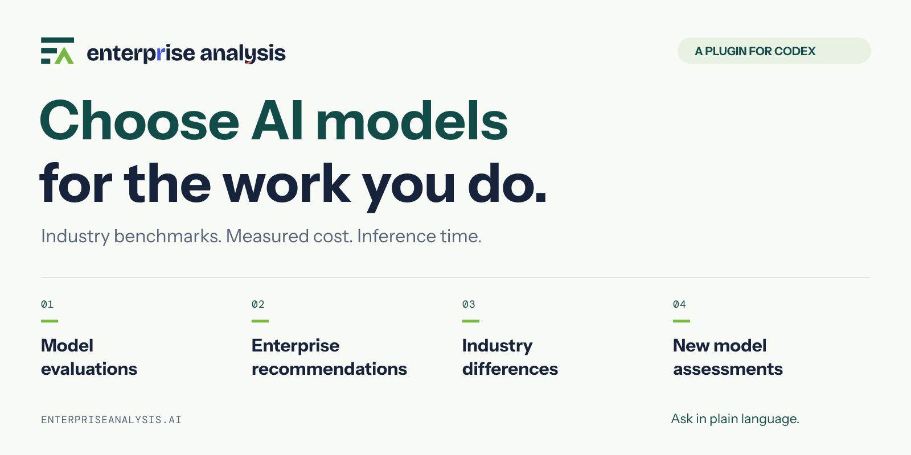

# Enterprise Analysis for Codex

**直接在 Codex 里查模型评测，结合行业得分、实测成本和推理耗时，为企业业务筛选模型。**

[English](README.md) · [查看 EA 榜单](https://enterpriseanalysis.ai/) · [安装步骤](#本地安装)

## 四类问题，直接问

| 你想做什么 | 可以这样问 |
| --- | --- |
| 模型评测对比 | “GPT 和 Claude 在金融行业哪个表现更好？” |
| 企业模型推荐 | “公司想做 AI 客服，用哪个模型？别太贵，回复快一点。” |
| 比较行业差异 | “做金融和做电商，选模型有什么区别？” |
| 查看新模型评测 | “刚出的这个模型测了吗？比上一代进步大不大？” |

插件会查找具体模型版本和推理档位，读取同一榜单中的行业分数、每 Case 成本与耗时，并保留评测中、争议和缺失数据标记。需要了解评分依据时，也可以问“这个榜单怎么测的，分数怎么算？”

## 本地安装

当前提供本地开发版，尚未上架公共插件目录。准备 Node.js 20 或以上版本，克隆仓库并安装：

```sh
git clone https://github.com/enterpriseanalysis/enterprise-analysis-plugin.git
cd enterprise-analysis-plugin
npm ci
codex plugin marketplace add .
codex plugin add enterprise-analysis@enterprise-analysis-dev
```

新开 Codex 聊天后测试。桌面端未加载时，完全退出应用并重新打开。如果客户端复制插件时没有带上依赖，在安装命令返回的目录中执行 `npm ci`。

查询公开 EA 数据不需要 EA 账号或 API Key。首次可以明确点名：

```text
用 Enterprise Analysis 比较 GPT 和 Claude 在金融行业的表现。
```

随后用不带品牌的自然问题测试触发。

**看调用记录确认是否成功：**“已读取 Evaluate Models 技能”表示加载了使用说明；“Find EA models and industry dimensions”“Compare AI model benchmark results”等工具调用，才是插件实际查询数据。只加载技能或搜索网页不算查询成功。

## 适合用来筛选实测候选

推荐工具按行业、最低得分、每 Case 成本和耗时上限筛选模型，再按所选分数排序。自动推荐要求评测状态明确、已完成且无争议；成本上限要求费用统计覆盖完整。

成本是基准测试的每 Case 美元费用，耗时是基准测试推理时间。它们不能直接当作你的生产账单、首字延迟或完整客服响应时间。新模型查询仅覆盖 EA 所选指数已收录、具有明确发布日期的配置；插件读取已有评测，不会替你发起新评测。

## 工具与数据

插件包含一份选型 Skill 和六个只读 MCP 工具，覆盖模型发现、评测对比、企业推荐、行业比较、新模型查询和方法说明。工具列表及开发入口见 [英文 README](README.md#included-tools)。

适配层只向后端发送榜单标识，模型与行业筛选在本地完成，不发送聊天记录、用户文件或凭据，也不添加请求内容日志。
